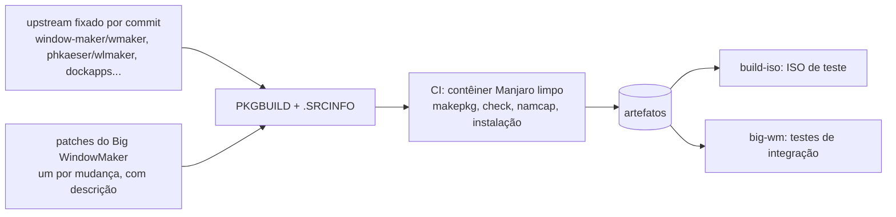

<p align="center">
  
</p>

<h1 align="center">Big WindowMaker — pacotes</h1>

<p align="center">
  <a href="https://github.com/big-windowmaker/packages/actions/workflows/build.yml"></a>
  
</p>

<p align="center">
  <a href="#instalar-os-pacotes">Instalar</a> ·
  <a href="#como-os-pacotes-são-feitos">Como são feitos</a> ·
  <a href="#compilar-localmente-com-podman">Compilar</a> ·
  <a href="#atualizar-um-pacote">Atualizar</a> ·
  <a href="#contribuir">Contribuir</a> ·
  <a href="#créditos">Créditos</a> ·
  <a href="#in-english">English</a>
</p>

PKGBUILDs dos pacotes próprios da distribuição **Big WindowMaker** (baseada em
BigLinux/BigCommunity/Manjaro). Cada diretório da raiz é um `pkgbase`, com o
`PKGBUILD`, a `.SRCINFO` gerada por `makepkg --printsrcinfo` e, quando houver,
os patches. Todo push em `main` compila os pacotes alterados num contêiner
Manjaro limpo, roda `check()`, instala os pacotes e passa o `namcap`; os
pacotes ficam disponíveis como artefatos por 30 dias e são usados pelo
[build-iso](https://github.com/big-windowmaker/build-iso) e pelos testes de
integração do [big-wm](https://github.com/big-windowmaker/big-wm).

| Diretório | Pacotes gerados | Versão | Origem |
|---|---|---|---|
| [`windowmaker/`](windowmaker/PKGBUILD) | `windowmaker` | `0.96.0.r130.g558e67f-25` | `master` do [window-maker/wmaker](https://github.com/window-maker/wmaker) fixado no commit `558e67f`, com 30 patches da branch `big-wm/missao-2026-11` do [fork](https://github.com/big-windowmaker/wmaker) (0016: dockapp acoplado inicia com a sessão; 0017: dicas do Motif mudadas com a janela aberta; 0018: arrastar um dockapp que pede os cliques e o menu do Window Maker dele). Substitui o `extra/windowmaker 0.96.0`. |
| [`wlmaker/`](wlmaker/PKGBUILD) | `wlmaker` | `1:0.8.r80.g7481afe-35` | `main` (desenvolvimento da 0.9) do [phkaeser/wlmaker](https://github.com/phkaeser/wlmaker) fixado no commit `7481afe`, com os patches das branches `big-wm/protocols`, `big-wm/zones` e `big-wm/missao-2026-11` do [fork](https://github.com/big-windowmaker/wlmaker), XWayland, contra `wlroots0.20`. 0122-0131: dockapps do X11 (XWayland) no Dock e no Clip com forma, menus e diálogos; Info Panel no duplo clique do Dock (o comando vem de `Dock.InfoCommand` no `State.plist`, ex.: `InfoCommand = "/usr/bin/big-wm-about";`; sem ele, o duplo clique não faz nada); menu raiz fixável; tema novo na hora; zonas exclusivas em todas as camadas; 0130, correções da revisão; 0132-0143, dockapps de 64 px, Spectacle, menus, atributos de janela, Alt+Tab; 0144, integração de novembro; 0145, o `wlmdock` mantém o nome no tema novo; 0146, `wmake-zones pointer`; 0147, menus e popups no lugar no XWayland e no Wayland (o menu do GParted); 0148, o `wlmeyes --dockapp` arrastável para o Dock e o Clip. |
| [`big-dockapps/`](big-dockapps/PKGBUILD) | `libdockapp`, `wmcpuload`, `wmbattery`, `wmusic`, `wmshutdown`, `wmmoonclock`, `wmcube`, `wmudmount`, `wmnet`, `wmclock`, `wmmemload`, `wmsystemtray`, `pclock`, `wmwifi`, `minidock`, `minicontrol`, `wmapmload`, `mountapp`, `wmcalclock`, `wmtime`, `wmclockmon`, `wmtz`, `wmtop`, `wmfsm`, `wmmon`, `wmcliphist`, `wmgtemp`, `wmsun`, `wmcalc`, `wmpager`, `wmcpufreq`, `wmglobe`, `wmweather` | `20260412-12` | [window-maker/dockapps](https://github.com/window-maker/dockapps) fixado no commit `251e851`; `wmudmount` (3.0), `wmsystemtray` (1.4) e `mountapp` (3.0) vêm dos tarballs do SourceForge; `minidock` (1.9) e `minicontrol` (0.2) da Zenwalk; `wmapmload` (0.3.4) do site do autor; `wmweather` (2.4.8) do tarball da Debian; `wmeyes` (1.2) do cache de distfiles do FreeBSD. O `wmcliphist` grava no histórico do `big-wm-clipboard` (Super+V). O `wmusic` segue o player que está tocando e, em repouso, acorda uma vez por segundo (patch `wmusic-light-idle`). |
| [`wmpulsemixer/`](wmpulsemixer/PKGBUILD) | `wmpulsemixer` | `0.2.2-1` | Tag `0.2.2` do [polletfa/wmpulsemixer](https://github.com/polletfa/wmpulsemixer) (GPL-2.0). Volume da saída e do microfone pelo PulseAudio/PipeWire (`libpulse`): o volume padrão do Dock, logo abaixo da bandeja. Patch 0001: espera o servidor de áudio (login, reinício do PipeWire) em vez de sair, roda do mouse a partir do volume real, clique no menu de dispositivos sem efeito nos controles e sem avisos do GDK; a enviar ao autor. |
| [`biglinux-livecd/`](biglinux-livecd/PKGBUILD) | `biglinux-livecd` | `26.10.26-9` | **Temporário**, só para as ISOs de teste: `main` de [big-windowmaker/biglinux-livecd](https://github.com/big-windowmaker/biglinux-livecd), com o suporte à sessão live do Window Maker proposto ao upstream. Sai daqui quando a mudança estiver no `biglinux-stable`. |
| [`wmake-zones/`](wmake-zones/PKGBUILD) | `wmake-zones` | `0.4.1-1` | [big-windowmaker/wmake-zones](https://github.com/big-windowmaker/wmake-zones), tag `v0.4.1` (sem patches: o que eram os patches 0001-0005 da 0.3.1 está no código); o CI testa contra o windowmaker deste repositório (`.ci-localdeps`). Zonas de encaixe e mosaico de janelas: serviço X11 e dockapp do Window Maker, dockapp nativo do wlmaker, preferências e editor (GTK 3), página de manual e o núcleo estático usado pelo `wlmaker` (patches 0104-0121; o CI compila o `wmake-zones` antes, por `.ci-localdeps`). Zonas ligadas por padrão, Mosaico desligado. |
| [`gtk-nocsd/`](gtk-nocsd/PKGBUILD) | `gtk-nocsd` | `4.8-2` | Release 4.8 do [MorsMortium/gtk-nocsd](https://codeberg.org/MorsMortium/gtk-nocsd) (Codeberg). Tira a CSD das janelas GTK 3/4 e libadwaita; carregado pela sessão X11 do big-wm. |
| [`onestepback-gtk-theme/`](onestepback-gtk-theme/PKGBUILD) | `onestepback-gtk-theme` | `0.997-6` | Zip da 0.997 do [site do autor](http://www.vide.memoire.free.fr/pages/onestepback/onestepback.php). Tema GTK 2/3/4 NeXTSTEP da sessão (`GTK_THEME` no big-wm), com ajustes e as classes do libadwaita no `gtk-4.0`, e a variação `OneStepBack-Dark` do modo escuro (`big-wm-theme dark`), gerada no build. |
| [`qtstep-kvantum/`](qtstep-kvantum/PKGBUILD) | `qtstep-kvantum` | `0.r23.36dc0d3-2` | [andbgr/QTStep](https://github.com/andbgr/QTStep): tema NeXTSTEP do Kvantum para os aplicativos Qt. |
| [`retrothemes-firefox/`](retrothemes-firefox/PKGBUILD) | `retrothemes-firefox` | `0.r68.dfc4eea-2` | [matthewmx86/RetroThemesFirefox](https://github.com/matthewmx86/RetroThemesFirefox): temas retrô do Firefox, com um patch. |
| [`wdm/`](wdm/PKGBUILD) | `wdm` | `1.28-14` | [raorn/wdm](https://github.com/raorn/wdm) (WINGs Display Manager), com 5 patches. |

## Instalar os pacotes

- **Pela ISO** (recomendado): o Big WindowMaker já vem completo na
  [ISO de teste](https://github.com/big-windowmaker/build-iso/releases).
- **Num BigLinux/BigCommunity já instalado**: os pacotes ainda não estão num
  repositório público assinado. Compile e instale cada um pelo PKGBUILD
  (como usuário comum, nunca como root):

  ```sh
  git clone https://github.com/big-windowmaker/packages
  cd packages/wmake-zones        # ou windowmaker, wlmaker, big-dockapps...
  makepkg -si                    # baixa as dependências, compila, roda o check() e instala
  ```

  Ordem quando for compilar vários: `wmake-zones` antes do `wlmaker` (que
  liga no núcleo dele). O desktop em si (sessões, temas, ferramentas) vem do
  [big-wm](https://github.com/big-windowmaker/big-wm).
- **Pacotes já compilados**: cada execução do CI em `main` deixa os pacotes
  como artefatos por 30 dias (*Actions* → *build* → *Artifacts*);
  instale com `sudo pacman -U arquivo.pkg.tar.zst`.
- **Voltar atrás**: `sudo pacman -U` com o pacote anterior (o makepkg o deixa
  no diretório do PKGBUILD) ou `sudo pacman -S windowmaker` para o pacote da
  distribuição, quando existir.

## Como os pacotes são feitos



### Observações

- **windowmaker**: mesmas flags de configure do Arch, mais `--enable-pango` e
  `--enable-res`, e as dependências `libxres`, `libxkbfile`, `libjxl` e
  `libarchive` (ver `analysis/02-x11-wmaker-dockapps.md`, seção 2.3). O
  `check()` roda o `make check` do upstream. As sonames (`libwraster.so.6`,
  `libWINGs.so.3`, `libWUtil.so.5`, `libWMaker.so.1`) são as mesmas da 0.96.0.
  Um patch próprio faz o `setstyle` manter os caminhos absolutos das
  texturas dos temas (antes ele prefixava o diretório do tema e o papel de
  parede não carregava); a enviar ao upstream.
- **wlmaker**: snapshot do `main` (0.9 em desenvolvimento: `wlmdock` como
  binário separado, `ext-foreign-toplevel-list-v1`, `ext-image-copy-capture-v1`,
  `cursor-shape-v1`, correções de vazamentos e travamentos). O `pkgver` segue o
  `git describe` (conferido em `prepare()`) e leva `epoch=1`, porque
  `0.8.r80` < `0.8.1` para o `vercmp`. Os submódulos `libbase` e `inih` entram
  como fontes separadas, fixadas nos commits registrados no `7481afe`, e são
  ligados em `prepare()` com `git config submodule.<nome>.url` (padrão do
  Arch). Nova dependência de build: `librsvg` (exigida pelo CMake, usada só
  pelos exemplos). O `check()` roda os 16 testes do CTest.
  Os patches (`git format-patch` da branch `big-wm/protocols`, um commit por
  mudança, a enviar ao upstream) adicionam os protocolos `xdg-activation-v1`,
  `org_kde_kwin_server_decoration` (decoração do wlmaker nas janelas GTK3),
  `presentation-time`, `single-pixel-buffer-v1`, `xdg-foreign` v1/v2,
  `ext-idle-notify-v1`, `wlr-gamma-control`, `wlr-output-power-management`,
  `relative-pointer`, `wlr-virtual-pointer` e `virtual-keyboard`; corrigem o
  bloqueio de tela (sem foco de teclado quando um menu de bandeja estava
  aberto; bloqueio abandonado sem recuperação), o menu de clique direito que
  disparava o item sob o ponteiro num clique rápido e os dockapps que fechavam
  sem ponteiro no seat; e acrescentam a opção `--lazy_xwayland`.
  Também aproximam as janelas do Window Maker: duplo clique na barra de
  título enrola a janela (shade), "Miniaturize" funciona (botão, menu da
  janela e pedido do cliente; a janela volta pelo Alt+Tab ou ativação) e as
  janelas XWayland ganham o mesmo menu da janela.
  No Clip, `Clip.Dockapps` define a ordem dos dockapps (pelo nome do
  executável), que podem ser arrastados com Alt; a ordem fica salva em
  `~/.config/wlmaker/Dockapps.plist`. `Clip.Launchers` (mesmo formato dos
  lançadores do Dock) prende lançadores logo abaixo do Clip, mostrados por
  um segundo `wlmdock --clip`. O `AppID` dos lançadores é opcional (os
  `State.plist` da 0.8 não o tinham, e o `wlmdock` saía sem abrir).
  Janelas novas abrem centralizadas na área útil da saída sob o ponteiro
  (sem cobrir Clip, Dock e painéis; `WindowPlacement = Center`, como no
  Window Maker), e maximizar respeita a mesma área. O `wlmdock` e os
  dockapps saem limpos no logout (SIGTERM ou fim do compositor), sem core
  dump.
  Clique direito no Clip, num lançador do Dock ou do Clip e num dockapp (com
  Alt, ou na borda do quadrado) abre menus como os do Window Maker. Dock e
  Clip se arrastam para outro canto da tela (nunca os dois no mesmo canto),
  e a posição fica gravada em `~/.config/wlmaker/State.plist`. O `wlmdock`
  desenha com pixman por padrão (sem `WLR_RENDERER`), o que o faz aparecer
  também em VM e GPU onde o renderizador automático falhava.
  Como no Window Maker, o Dock tem um quadrado principal (logo do Big
  WindowMaker) que não pode ser removido: o menu dele muda o Dock de lado e
  restaura os lançadores padrão (os do `State.plist` do big-wm); o Clip
  também restaura os seus. Os menus aparecem em português.
  No dockapp de volume (`wlmmixer`), as barras coloridas acendem na
  proporção do volume, e clicar ou arrastar sobre elas ajusta o volume
  naquele ponto (no meio, 50%).
  Na 0.9 não há mais dock embutido e o `Config.plist` padrão não inicia o
  `wlmdock`: a configuração da sessão precisa colocá-lo (e o
  `wlmdock --clip`, se houver `Clip.Launchers`) no `Autostart`.
  Os `.desktop` dos dockapps e do `wlmdock` ganham `OnlyShowIn=wlmaker;`: na
  sessão X11 eles não abrem e apareciam no menu e no rofi.
- **big-dockapps**: num pacote split o `makepkg` não permite `pkgver` diferente
  por pacote. Por isso todos usam a data do commit fixado, que é maior que as
  versões do AUR. As versões upstream incluídas estão listadas no topo do
  `PKGBUILD`. A `libdockapp` (que não existe nos repositórios) entra no split
  porque `wmusic` e `wmcube` dependem dela. `wmclock`, `wmmemload` e `wmsystemtray` também
  entram: o servidor atual da BigLinux (`packages.biglinux.com.br`) não os
  tem mais, só o espelho antigo. Só o `wmix` continua vindo do BigLinux. O
  `wmnet` substitui o `wmnd`, ligado a uma `libsnmp` que não existe mais.
  `minidock`, `minicontrol`, `wmapmload` e `mountapp` não têm mais
  manutenção upstream e levam patches: `minidock` (GTK 2) e `minicontrol`
  (GTK 1.2) foram portados para GTK 3; `wmapmload` lê a bateria do
  `/sys/class/power_supply` em vez do `/proc/apm`; `mountapp` compila sem o
  configurador `mount.conf` (GTK 1.2) e só mostra os pontos de montagem
  `user` do `/etc/fstab` (para mídia removível, use o `wmudmount`). Os
  comandos padrão de `minidock` e `minicontrol` (`big-wm-open`, `WPrefs`,
  `systemctl poweroff`) ficam em `minidock.cf` e `minicontrol.cf`, fora dos
  patches.
  A segunda leva (`wmcalclock`, `wmtime`, `wmclockmon`, `wmtz`, `wmtop`,
  `wmfsm`, `wmmon`, `wmcliphist`, `wmgtemp`, `wmsun`, `wmcalc`, `wmpager`,
  `wmcpufreq`, `wmglobe` e `wmweather`) traz os dockapps mais conhecidos que
  faltavam: relógios e calendário, relógio mundial, processos, discos,
  temperatura, área de transferência, calculadora, paginador, frequência da
  CPU, globo e clima. Só três levam patch: `wmcpufreq` passa da
  `libcpufreq` (que não existe mais) para a `libcpupower` do `cpupower`,
  `wmglobe` compila com `-Werror=format-security` e `wmweather` passa `long`
  ao `curl_easy_setopt()`. O `wmglobe` liga na
  `libwraster`, cujas versões de símbolo diferem entre o nosso `windowmaker`
  e o do Manjaro: por isso o diretório tem `.ci-localdeps` com `windowmaker`.
  O `/etc/wmtzrc` do `wmtz` (arquivo `wmtzrc`) mostra UTC, Brasília, Lisboa,
  Nova York e Tóquio no lugar das datas julianas do upstream. Precisam de
  configuração ou de hardware: `wmweather` (código ICAO do aeroporto, ex.
  `wmweather -s SBGR -m`, e rede), `wmsun` (`-lat`/`-lon`, longitude
  positiva a oeste) e `wmcpufreq` (driver cpufreq: não abre em VM sem ele).
  O `wmusic` leva um patch próprio: segue o player MPRIS que está tocando (o
  primeiro da lista, muitas vezes o Firefox parado, escondia o player de
  verdade) e não congela mais quando o comando do player (`-c`, `xmms` por
  padrão) não abre um player MPRIS.
- **biglinux-livecd**: as dependências de execução só existem nos
  repositórios BigLinux, então o diretório tem `.ci-nodeps`: o CI compila sem
  resolver dependências e pula o teste de instalação.
- **onestepback-gtk-theme**: o `prepare()` ajusta só o `gtk-4.0/gtk.css`.
  Apaga a cor `text_view_bg`, para os terminais VTE (AshyTerm) ficarem
  translúcidos, e acrescenta o [`libadwaita.css`](onestepback-gtk-theme/libadwaita.css):
  com `GTK_THEME` definido o libadwaita não carrega a folha de estilo dele,
  e os aplicativos que usam `@window_bg_color`, `@popover_bg_color` ou
  `var(--window-bg-color)` no próprio CSS (Big Audio Player, Big Video
  Player, Big Recorder) abriam com o fundo transparente. O arquivo define
  essas cores e variáveis com os cinzas do tema, sem mudar nenhuma regra
  dele. Também tira o `;;` da linha 155 (`background-color: @darker_color;;`),
  que fazia o GTK 4 avisar "Empty declaration" em todo aplicativo. O
  [`libadwaita-widgets.css`](onestepback-gtk-theme/libadwaita-widgets.css)
  desenha, com o relevo do tema, as classes que só o libadwaita desenhava
  (`.card`, `.boxed-list`, `.pill`, `.suggested-action`, página de status,
  grupos de preferências, avisos, títulos...): sem ele os cartões do
  instalador do BigLinux sumiam.
  O `build()` gera o `OneStepBack-Dark` a partir do tema já ajustado: o
  [`dark.sed`](onestepback-gtk-theme/dark.sed) troca os três cinzas por
  cinza-escuros e dá ao texto (que o tema escreve com `@black_color`) uma
  cor clara própria, sem tocar no preto das sombras do relevo; o
  [`dark-gtk2.sed`](onestepback-gtk-theme/dark-gtk2.sed) faz o mesmo no
  GTK 2; o [`dark.css`](onestepback-gtk-theme/dark.css) acerta a barra de
  título fora de foco; e o ImageMagick reescurece as imagens dos controles
  (setas e caixas invertem, barras de rolagem escurecem). O `check()`
  confere cada troca.
- **qtstep-kvantum**: além das 25 variações do QTStep, o
  [`colors.OpenStepDark`](qtstep-kvantum/colors.OpenStepDark) gera pelo
  mesmo modelo o `QTStepOpenStepDark`, o OpenStep em cinza-escuro do modo
  escuro do Big WindowMaker (o `QTStepDark` do projeto tem fundo `#101010`,
  quase preto).

## Política

1. **Fontes fixadas.** Todo `source` aponta para um commit (`#commit=`) ou para
   uma tag cujo commit é conferido em `prepare()`, ou para um tarball de
   release. Todos têm `sha256sums` reais: o `makepkg` também calcula checksum
   de fontes git. `SKIP` não é aceito.
2. **Sem segredos no build.** O CI de build roda com `permissions: contents:
   read`, sem nenhum segredo, e só gera artefatos. Assinatura e publicação no
   repositório ficam num pipeline separado, com environment protegido.
3. **Actions e imagens fixadas.** Toda `uses:` é fixada por SHA completo, com a
   versão em comentário, e o Dependabot abre PRs de atualização. A imagem
   `manjarolinux/base` é fixada por digest e atualizada manualmente.
4. **makepkg sem root.** O build roda como usuário sem privilégios dentro do
   contêiner. Esse usuário só pode chamar o `pacman` via sudo, para instalar
   as dependências.
5. **namcap obrigatório.** O `namcap` roda no `PKGBUILD` e em cada pacote
   gerado. Os pacotes também são instalados no contêiner descartável, como
   teste de instalação.
6. **Patches pequenos e rastreáveis.** Patches ficam em `<pkgbase>/` e cada um
   deve apontar para o PR correspondente no upstream. Tema e configuração não
   entram como patch: ficam nos pacotes de configuração.

## Compilar localmente com podman

Não é preciso instalar nada no sistema. Basta o `podman` sem root:

```sh
git clone https://github.com/big-windowmaker/packages
cd packages
mkdir -p out/windowmaker

podman run --rm \
  -v "$PWD":/repo:ro \
  -v "$PWD/out/windowmaker":/out \
  docker.io/manjarolinux/base@sha256:bbf1f1d746f28e138eea610e140d2f28cbb5b7c5da2fbff034b883527aa604e9 \
  bash /repo/ci/build-package.sh windowmaker /out
```

Troque `windowmaker` por `wlmaker` ou `big-dockapps`. O script
[`ci/build-package.sh`](ci/build-package.sh) é o mesmo usado no CI. Ele:

1. atualiza o contêiner e instala `base-devel`, `git` e `namcap`;
2. cria o usuário `builder`, sem privilégios;
3. copia o diretório do pacote para dentro do contêiner (o repositório é
   montado só para leitura);
4. roda o `namcap` no `PKGBUILD` e confere se a `.SRCINFO` está em dia;
5. roda `makepkg --syncdeps --cleanbuild` (com `check()`);
6. instala os pacotes gerados e roda o `namcap` em cada um;
7. copia os pacotes, os logs e os relatórios do namcap para `/out`.

O build acontece dentro do sistema de arquivos do contêiner. Isso evita
problemas com `/tmp` montado como `noexec` no host.

## Atualizar um pacote

1. Edite o `PKGBUILD`: commit ou tag, `pkgver`, e `pkgrel=1`.
2. Regenere os checksums e a `.SRCINFO` dentro do contêiner, com
   [`ci/update-sums.sh`](ci/update-sums.sh). O `--userns=keep-id` mantém os
   arquivos com o seu usuário:
   ```sh
   podman run --rm --userns=keep-id --user root -v "$PWD":/repo \
     docker.io/manjarolinux/base@sha256:bbf1f1d746f28e138eea610e140d2f28cbb5b7c5da2fbff034b883527aa604e9 \
     bash /repo/ci/update-sums.sh <pkgbase>
   ```
   Confira no `git diff` se só mudou o que era esperado.
3. Compile como descrito acima e abra um PR. O CI compila só os diretórios
   alterados, ou todos quando `ci/` ou o workflow mudam.

## Contribuir

- Correção num pacote: um commit por mudança, com `pkgrel` novo, `.SRCINFO`
  regenerada (`makepkg --printsrcinfo > .SRCINFO`) e checksums atualizados;
  o CI compila o diretório alterado e roda o `namcap`.
- Patch no Window Maker ou no wlmaker: o código vem dos ramos `big-wm/*` dos
  forks ([wmaker](https://github.com/big-windowmaker/wmaker),
  [wlmaker](https://github.com/big-windowmaker/wlmaker)), exportado com
  `git format-patch`; o que servir a todos também segue para o upstream.
- Problemas: [issues](https://github.com/big-windowmaker/packages/issues);
  guia: [CONTRIBUTING](https://github.com/big-windowmaker/.github/blob/main/CONTRIBUTING.md).

## Créditos

### Mantenedores do Big WindowMaker

- **Rafael Ruscher** — <rruscher@gmail.com>
- **Barnabé Di Kartola** — <barnabedikartola@gmail.com>

Nos pacotes de projetos de terceiros, os autores e mantenedores originais
continuam nas linhas `# Contributor:` e no campo `url`; o Big WindowMaker
mantém o empacotamento e os patches de integração.

### Agradecimentos especiais

- **Alfredo Kojima** — pelo [Window Maker](https://www.windowmaker.org/) e
  pelo legado que inspirou este projeto.
- **Philipp Kaeser** — pelo [wlmaker](https://github.com/phkaeser/wlmaker),
  que leva a inspiração do Window Maker ao Wayland.
- **Bruno Gonçalves** — pelo [BigLinux](https://www.biglinux.com.br/) e por
  suas contribuições ao ecossistema Linux.
- **Tales A. Mendonça** — pelas contribuições à
  [BigCommunity](https://communitybig.org).

## Licença

Os arquivos deste repositório (PKGBUILDs, scripts e configuração) seguem a
convenção do Arch Linux e estão sob a licença [0BSD](LICENSE). O software
empacotado mantém a licença do seu upstream, registrada no campo `license` de
cada pacote.

## In English

PKGBUILDs of the Big WindowMaker packages: Window Maker and wlmaker from
pinned upstream commits plus the Big WindowMaker patches, curated dockapps,
wmake-zones, retro themes and the live-session/installer package. Every push
builds the changed packages in a clean Manjaro container (makepkg with
`check()`, install test, namcap) and keeps them as CI artifacts used by the
ISO and the integration tests. Build any of them with `makepkg -si` as a
regular user. Maintainers: Rafael Ruscher and Barnabé Di Kartola; upstream
authors stay credited in each PKGBUILD. PKGBUILDs: 0BSD.
